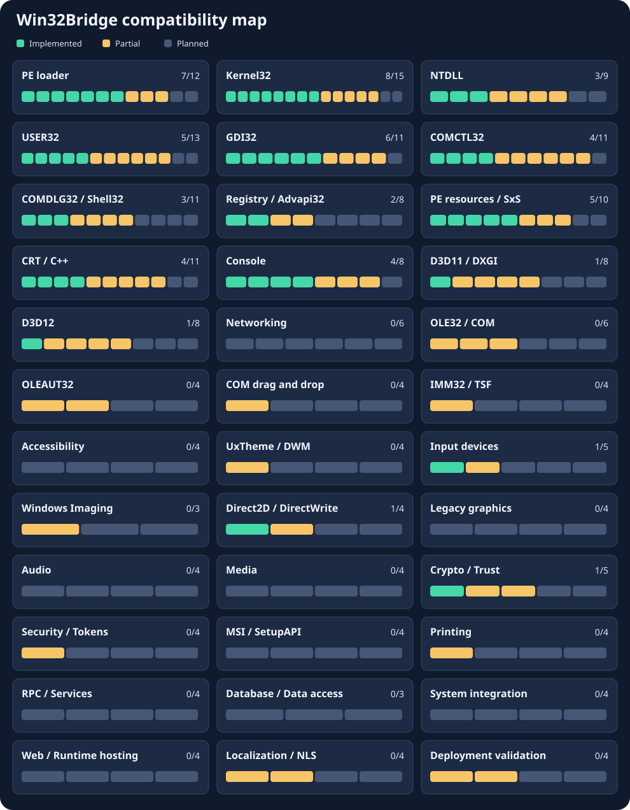

# Win32Bridge


Win32Bridge is an experimental compatibility layer for running native Windows x64 applications inside the Desktop Mode UWP shell. Its main targets are Windows UWP and Xbox Developer Mode. Guest machine code executes on the host CPU inside the runtime process. The bridge maps PE images, supplies guest-facing Win32 APIs, and presents application windows or console output through the shell.

## Compatibility map



Each segment is one milestone. See the [detailed compatibility inventory](COMPATIBILITY.md) for counts by library and the status of every tracked capability. The count in each tile shows implemented milestones out of the tracked total for that area. Amber covers partial, stubbed, or host-dependent implementations. Slate covers planned, deferred, and out-of-scope work. Windows export coverage and Xbox test results are separate measures.

To update the map and inventory, edit the [milestone list](Tools/Generate-CompatibilityMap.py) and run `python Win32Bridge/Tools/Generate-CompatibilityMap.py` from the repository root.

## Execution model

1. Desktop Mode launches a runtime session from Files, a guest Start Menu shortcut, or the Terminal entry.
2. [PeImage, PeMapper, and RuntimeImage](Bridge/RuntimeImage.cpp) parse and map the PE32+ image, apply relocations and section protections, register x64 unwind metadata, and prepare thread-local storage.
3. [ImportBinder](Bridge/ImportBinder.cpp) and [GuestModule](Bridge/GuestModule.cpp) bind imports and resolve guest dependencies by module, name, or ordinal. Resolution includes delay imports, forwarded exports, API-set mapping, and activation-context redirects. DLL and TLS callbacks participate in process and thread initialization and teardown.
4. [GuestRuntime](Bridge/GuestRuntime.cpp) sets up the guest environment and transfers execution to the entry point. GUI applications use virtual HWNDs in a shell-managed window. Console applications use the virtual console and the shell's Terminal frontend.

Import resolution can select a bridge implementation, a supported host API, or an export from a mapped guest DLL. Generated export aliases and optional stubs help resolve some imports. A resolved symbol establishes that an entry point is available. Its behavior depends on the implementation behind it.

### App-local DLL overrides

To select an app-supplied library, place the x64 DLL and a text file named after the full executable name plus `.dll-overrides` beside the executable. For example, `game.exe.dll-overrides` can contain:

```text
# Use the D3D9 implementation shipped with this application.
d3d9.dll
```

The profile is read at guest startup. Use one DLL basename per line, with optional blank lines and `#` comments. Eligible names are `d3d8.dll`, `d3d9.dll`, `ddraw.dll`, `d3dcompiler_43.dll`, `d3dcompiler_46.dll`, `d3dcompiler_47.dll`, `dinput.dll`, `dinput8.dll`, `dsound.dll`, `opengl32.dll`, `vulkan-1.dll`, `winmm.dll`, XAudio2 versions 2.7 through 2.9, and XInput versions 1.1 through 1.4 and 9.1.0. Other entries are ignored with a diagnostic.

A configured module takes precedence when requested by basename, including delay loads and dynamic lookups. A missing DLL, failed initialization, or missing export is reported through the corresponding loader error. Absolute or relative path requests and resource-only mappings keep their existing behavior. Each child executable reads its own profile. Check the runtime log for `DLL OVERRIDE ACTIVE` and the final import report for bindings from the app-local image.

## Implemented subsystems

| Area | Current implementation |
| --- | --- |
| PE resources and activation | Resource lookup by type and name, string tables, menu and dialog templates, icons, bitmaps, cursors, version information, and raw resources. Manifest support includes activation contexts, guest assembly lookup, and Common Controls redirection. See [GuestResources](Bridge/GuestResources.cpp) and [ActivationContext](Bridge/ActivationContext.cpp). |
| USER32 and Common Controls | Virtual window classes, focus and modality, message queues and cross-thread sends, invalidation and paint regions, menu and context-menu tracking, accelerators, dialog navigation, and property-sheet pages. Built-in controls include Edit, ListView, TreeView, Tab, Toolbar, Rebar, and StatusBar. Message, notification, and custom-draw coverage varies by control. See [GuestWindow](Bridge/GuestWindow.cpp), [GuestMessageQueue](Bridge/GuestMessageQueue.cpp), and [Common Controls](Bridge/CommonControlsShims.cpp). |
| GDI and text | MiniGDI device contexts, transforms and clipping regions, paths and drawing primitives, DIBs, raster operations, alpha and transparent blits, and DirectWrite-backed text layout and metrics. See [GDI sources](Bridge/GDI/). |
| DirectX | Host-backed D3D11 and D3D12 rendering with windowed DXGI presentation. The GPU surface takes over after the first submitted frame. D3D11 preserves guest COM identity across contexts, buffers, textures, views, direct DXGI surfaces and keyed mutexes. Subresource surfaces retain a separate identity and return their guest parent. D3D12 includes wrapped queues and fences and a device factory that checks host SDK availability. See [DirectX sources](Bridge/DirectX/) and [GraphicsContracts](GuestApps/GraphicsContracts/README.md). |
| Files and synchronization | Virtual drive C: backed by app-local storage, guest handles and share modes, handle duplication and inheritance, mappings, named pipes, directory changes, byte-range locks, and overlapped and native file I/O with cancellation and completion ports. Includes guest events, mutexes, semaphores, and timers. See [File handles](Tools/FILE-HANDLES.md) and [Pipes](Tools/PIPES.md). |
| Processes and console | CreateProcessA/W launches supported PEs with guest process and thread handles. The bridge supports suspended startup and `STARTUPINFOEX` handle lists for selective inheritance. Toolhelp and PSAPI expose guest state within the session. Console support includes screen buffers, input records, standard streams, file and pipe redirection, and terminal presentation. See [GuestRuntime](Bridge/GuestRuntime.cpp), [Console](Tools/CONSOLE.md), and [Terminal](Tools/TERMINAL.md). |
| Registry | A persistent guest registry with machine and user hives. SYSTEM and SOFTWARE are stored under `drive_c\Windows\System32\config`, and the default user hive is stored as `drive_c\Users\Default\NTUSER.DAT`. These files use the bridge's own serialized format. See [GuestRegistry](Bridge/GuestRegistry.cpp). |
| C and C++ runtime | CRT adapters for startup, heap and aligned allocation, descriptors and stdio, formatting and scanning, locale and multibyte conversions, and console I/O. The x64 C++ exception path includes MSVC exception metadata handling, RTTI, and exception pointer support. See [CRT sources](Bridge/CRT/), [CRT exception handling](Tools/CRT-EH.md), and [CRT streams](Tools/CRT-STREAMS.md). |
| Shell integration | Virtual file dialogs, Shell folder and context-menu interfaces, a properties verb backed by guest file metadata, and Start Menu discovery of guest .lnk files. The shell reads PE icons for shortcuts and running windows. See [Shell32 shims](Bridge/Shell32Shims.cpp), [File dialog COM support](Bridge/FileDialogCom.inl), and [Start shortcuts](../factoryos-10x-shell/Services/GuestRuntime/Win32StartShortcuts.cs). |

## Running and validating

Open an x64 executable from **Files** in Desktop Mode. Keep its companion DLLs and data files in the directory structure expected by the application. After guest Windows files have been provisioned, the **Terminal** entry launches the guest CMD. Shortcuts under the guest Start Menu directories can also provide launch entries.

Use the import and runtime logs in the app's LocalState to distinguish a missing import from a failure during initialization or later execution. When emitted, the crash log adds native exception details. [Audit-GuestImports.py](Tools/Audit-GuestImports.py) supports static triage of PE imports. Resolution audits alone do not exercise the APIs.

| Test asset | What it checks |
| --- | --- |
| [FileHandleContracts](GuestApps/FileHandleContracts/README.md) | File descriptions, handle lifetime, synchronization, I/O, process and thread shutdown, suspended startup, lookup by guest ID, and selective inheritance of guest handles. The latest process and inheritance checks await a build and Xbox run. |
| [DialogContracts](GuestApps/DialogContracts/README.md) | Dialog behavior and message routing. |
| [GraphicsContracts](GuestApps/GraphicsContracts/README.md) | D3D11 and D3D12 presentation and resize, plus D3D11 resource and surface identity, keyed mutexes, GPU completion events, D3D11On12 and selected shared-handle and factory paths. The latest fixture checks await a Bridge build and Xbox run. |
| [Xbox validation suite](GuestApps/Validation/README.md) | Six menu-driven test apps staged in `C:\Windows\test_apps`, with one log per executable. |
| [BridgeTests](GuestApps/BridgeTests/) | Focused CRT, console, loader, and other compatibility fixtures. |

7-Zip, classic Notepad, Notepad++, and CMD have been used during development. These are application test targets. Compatibility varies with the executable version, exercised feature, build, and host. A successful launch is only one part of validation.

## Planned work

- **Loader and imports.** Expand API behavior based on shared contracts and real binaries. Continue testing dependency search and initialization order, unload and unwind edge cases, and import resolution across application-local and system module layouts. Use ReactOS and primary Windows documentation as references for semantics.
- **Windowing and controls.** Improve paint, clipping, resize and focus behavior, nested modal loops, owner-draw notifications, and the fidelity of common controls. Exercise these paths through operations such as opening, saving, editing, and closing documents.
- **CRT and C++.** Expand dynamic MSVCP/STL coverage and verify ABI compatibility across modules. Finish console locale and code-page edge cases and validate exception propagation across guest DLL boundaries.
- **DirectX.** Extend sharing by name and access rights, resolve Direct2D and WinRT resource interoperability, and preserve D3D12 identity through command lists, heaps and resources. Validate the first-frame handoff, resize, device-loss recovery and D3D12 SDK selection on Windows UWP and Xbox. D3D12 features depend on the host runtime.
- **Storage and system services.** Local file renames preserve handle paths, share modes, and byte-range locks. Remaining filesystem work includes case-only renames, stronger directory move atomicity, and file identity across path aliases and overlay boundaries. Plan REGF-compatible hives and broaden COM and activation-context contracts. Full host WinSxS integration and language fallback remain future work.
- **Release validation.** Run the contract fixtures and representative GUI, console, and graphics workloads on Windows UWP and Xbox. Record results per host and build. Networking is deferred.

## Scope

The supported guest architecture is native x64 PE32+. Compatibility depends on the host UWP capabilities and on how much of the guest's API behavior is implemented. Guest process and window abstractions live within the bridge. Applications that require kernel drivers, privileged services, or desktop OS integration outside the host's available capabilities are outside the current scope.
